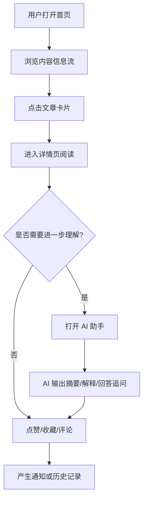
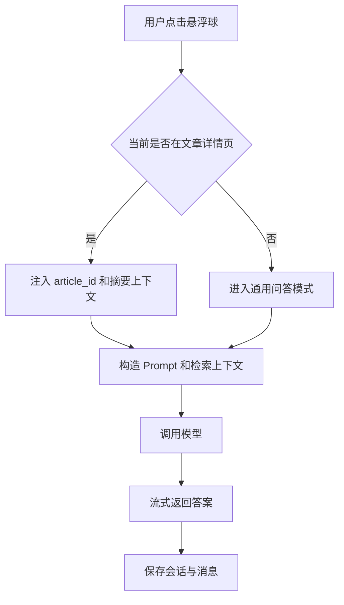
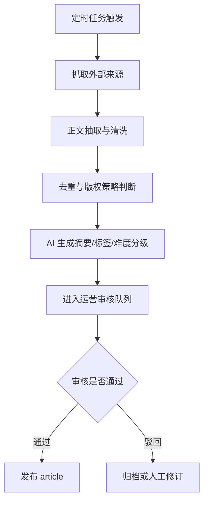
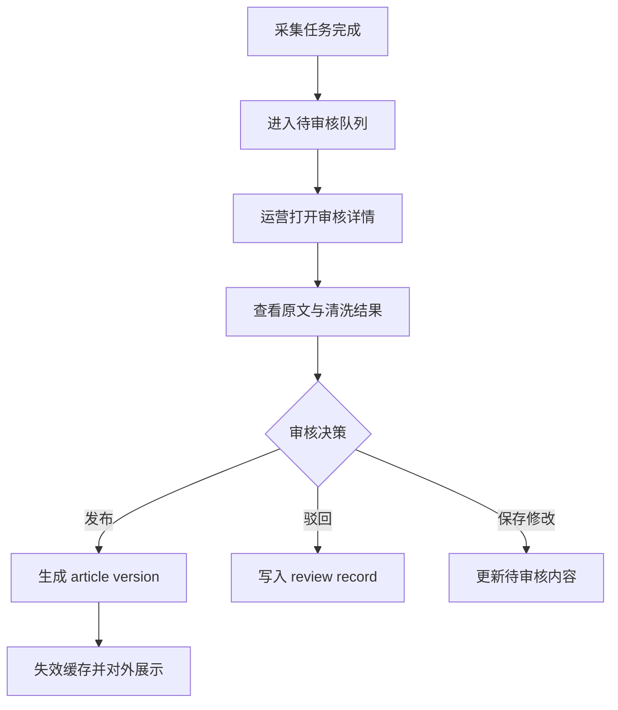
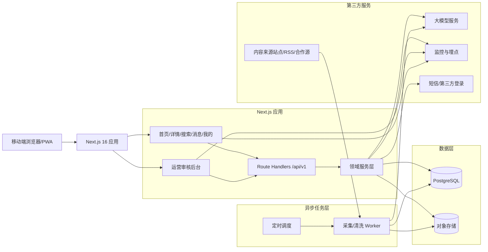
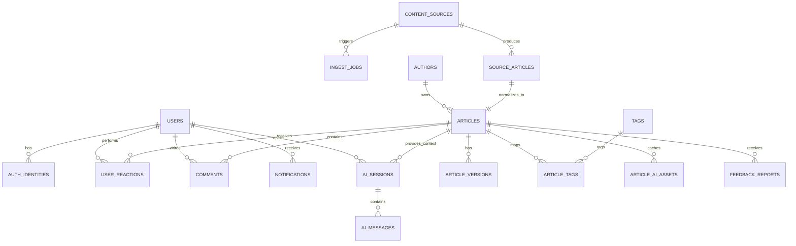

# SciencedAIly 产品需求与技术方案文档

---

## 0. 文档信息

| 项目 | 内容 |
| --- | --- |
| 当前版本 | 1.1 |
| 当前阶段 | 需求评审 + 技术方案冻结 |
| 创建人 | 马晨熙 |
| 创建日期 | 2026-04-09 |
| 最后更新 | 2026-04-09 |
| 核心干系人 | 产品、研发、设计、运营 |

---

## 1. 产品概述

### 1.1 产品定位

SciencedAIly 是一个聚焦前沿科学内容消费与 AI 陪读体验的移动端内容产品，可以理解为“科学版推特 + AI 科普助手”。

核心价值：

- 高质量内容聚合：用运营筛选和结构化标签组织前沿科学内容
- AI 降低理解门槛：对长文做摘要、概念解释、延展问答和趣味改写
- 轻量社区氛围：先做内容消费和互动，再逐步演进到 UGC 社区

### 1.2 核心口号

「用 AI，为人科学」

### 1.3 目标用户

| 画像 | 特征 | 核心诉求 |
| --- | --- | --- |
| 科学爱好者 | 对 AI、生命科学、心理学、环境等领域有持续兴趣 | 需要高质量、可持续追更的内容 |
| 泛科技年轻人 | 希望快速理解跨学科热点 | 需要低门槛、可快速吸收的解释 |
| 学生群体 | 有学习和表达需求 | 需要摘要、要点梳理、概念释义 |

### 1.4 MVP 核心假设

MVP 要验证两件事：

1. 用户是否愿意持续消费高质量科学内容
2. 用户是否会主动使用 AI 进行“陪读”和追问

---

## 2. MVP 范围说明

### 2.1 本阶段目标

MVP 阶段的目标不是一次性做完整社区，而是先跑通“内容分发 + AI 解读 + 基础互动”闭环：

1. 跑通首页、详情页、搜索、AI 助手等核心前台体验
2. 跑通内容采集、审核、发布的后台链路
3. 构建可持续扩展的数据模型和 API 边界，避免后续推翻重做

### 2.2 MVP In Scope

- 内容信息流首页
- 文章详情页
- AI 解读助手
- 搜索
- 点赞、收藏、评论、举报/纠错
- 个人中心
- 消息中心
- 游客会话/轻登录
- 内容采集与运营审核后台

### 2.3 MVP Out of Scope

以下能力不在 MVP 首批交付范围内：

- 普通用户发文
- 创作者认证与创作者工作台
- 付费会员、变现体系
- 群聊、圈子、私信
- 视频、播客、漫画等多内容形态
- 多端原生 App

### 2.4 MVP 约束澄清

为避免需求自相矛盾，MVP 做如下约束：

- 普通用户暂不支持发布文章，因此“你的文章收到赞”类创作者通知不进入 MVP
- 个人中心不展示“我的发布”“草稿”，改为“我的收藏”“我的点赞”“我的 AI 会话”
- 登录采用游客优先策略，只有点赞、收藏、评论、查看个人历史等持久化行为需要账号态

### 2.5 内容来源策略

MVP 阶段以外部内容聚合为主，来源包括：

- 科技媒体
- RSS/公开网页
- 合作内容源
- 指定平台公开内容

内容侧默认遵循“来源可追溯、版权可审计、展示可控”原则：

- 默认展示来源链接和平台内摘要
- 对未获得全文授权的来源，仅展示摘要/摘录，不默认长期托管完整正文
- 对明确授权或公共许可内容，可存储和展示完整正文

---

## 3. 功能需求

### 3.1 功能优先级

| 优先级 | 功能模块 | 说明 |
| --- | --- | --- |
| P0 | 内容信息流 | 首页核心消费入口 |
| P0 | 详情页 | 完整阅读体验 |
| P0 | AI 解读助手 | 核心差异化能力 |
| P0 | 内容采集与审核后台 | 没有这条链路就无法持续供给内容 |
| P1 | 搜索 | 关键词快速发现内容 |
| P1 | 点赞/收藏/举报纠错 | 形成基本互动闭环 |
| P2 | 评论 | 补足轻社区感 |
| P2 | 消息中心 | 承接互动和系统通知 |
| P2 | 个人中心 | 承接收藏、点赞、会话历史 |
| P2 | 登录/注册 | 游客升级为正式用户 |

### 3.2 详细功能说明

#### 3.2.1 首页（内容信息流）

功能描述：展示科学文章列表，支持分类筛选、排序和分页加载。

核心要素：

- 文章卡片：标题、摘要、作者、发布日期、领域标签、阅读时长、点赞数
- 筛选维度：
  - 学科：人工智能、生命与健康、脑与心理、社会与行为、经济金融、环境与气候
  - 形式：文章
- 排序：最新优先，预留热门排序
- 分页：下拉刷新 + 光标分页加载更多

交互说明：

- 点击卡片进入详情页
- 点击标签触发筛选
- 首页支持记录已读状态和最近浏览

#### 3.2.2 详情页

功能描述：展示文章详细内容，并承载 AI 解读与互动行为。

核心要素：

- 标题、作者、来源、发布时间
- 正文内容或摘要内容
- 底部互动区：点赞、收藏、评论、举报/纠错
- 推荐阅读
- AI 一键操作：总结要点、解释概念、趣味改写

交互说明：

- 点赞/收藏后即时更新 UI
- 举报/纠错后进入工单流转
- 若是仅授权摘要内容，详情页保留“查看原文”跳转

#### 3.2.3 AI 解读助手（悬浮球）

功能描述：全局 AI 助手，支持上下文感知问答。

触发方式：

- 页面右下角悬浮球
- 详情页中的快捷问题入口

核心能力：

- 文章摘要：提炼核心观点和结论
- 概念解释：把术语翻译成用户能听懂的表达
- 趣味改写：把晦涩内容改写成更容易传播的科普文案
- 延展问答：围绕当前文章持续追问
- 通用问答：在非详情页场景下回答泛科学问题

交互说明：

- 在详情页中自动绑定当前文章上下文
- 支持流式输出
- 支持展示引用来源和免责声明

#### 3.2.4 搜索

功能描述：按关键词、标签和学科搜索内容。

交互说明：

- 首页顶部搜索入口
- 输入关键词后返回匹配文章
- 支持高亮命中词
- 支持最近搜索和热门搜索

#### 3.2.5 互动与反馈

功能描述：提供用户基本参与能力。

MVP 包含：

- 点赞
- 收藏
- 评论与回复
- 举报/纠错

业务约束：

- 游客可浏览，持久化互动需要登录态
- 举报/纠错必须记录原因和状态流转
- 评论需要支持审核和屏蔽

#### 3.2.6 消息中心

功能描述：聚合用户相关通知。

MVP 通知类型：

- 评论回复通知
- 评论被点赞通知
- 举报/纠错处理进度
- 系统通知

说明：

- 由于 MVP 不开放普通用户发文，暂不支持“文章作者获赞通知”

#### 3.2.7 个人中心

功能描述：沉淀用户行为资产。

核心要素：

- 头像、昵称、简介
- 我的收藏
- 我的点赞
- 我的 AI 会话
- 账号设置

#### 3.2.8 登录/注册

功能描述：为持久化互动和历史记录提供账号能力。

MVP 方案：

- 默认游客会话
- 点赞、收藏、评论、查看 AI 历史时触发登录
- 首期可采用验证码登录或模拟登录
- 后续再接入微信/短信等正式登录

#### 3.2.9 内容采集与审核后台

功能描述：支撑内容供给链路。

后台能力：

- 内容源配置
- 定时采集
- 去重和清洗
- AI 自动打标签与摘要生成
- 运营审核
- 发布/下线

---

## 4. 业务流程

### 4.1 用户消费主流程



### 4.2 AI 解读流程



### 4.3 内容采集与发布流程



---

## 5. 技术方案总览

### 5.1 技术设计原则

- 单仓优先：前台 Web、BFF API、运营后台尽量在同一 Next.js 项目内完成
- 读写分离：读接口强调缓存和首屏速度，写接口强调鉴权、幂等和审计
- 数据可追溯：外部来源、清洗结果、发布版本必须可追溯
- AI 可替换：模型调用通过适配层隔离，避免绑定单一供应商
- 合规优先：默认按“链接优先、摘要优先、全文需授权”设计

### 5.2 推荐技术栈

| 层级 | 选型 | 说明 |
| --- | --- | --- |
| Web 框架 | Next.js 16 App Router | 统一前台、运营台和 BFF |
| UI | React 19 + Tailwind CSS 4 | 适合移动端内容产品快速迭代 |
| API 形态 | Route Handlers + 少量 Server Actions | 外部契约清晰，适配后续多端 |
| 领域层 | TypeScript Service Layer | 复用内容、AI、用户、通知逻辑 |
| 主数据库 | PostgreSQL | 关系模型清晰，适合内容、互动、审计 |
| 对象存储 | Supabase Storage 或 S3 兼容存储 | 存放封面图、抓取快照、原始 HTML |
| 搜索 | PostgreSQL Full-Text Search + trigram | 满足 MVP 规模，降低外部依赖 |
| AI 服务 | 大模型适配层 | 主接国产模型，保留切换能力 |
| 异步任务 | 独立 Node Worker + 定时调度 | 采集和清洗不阻塞前台请求 |
| 监控分析 | Sentry + PostHog | 错误监控和产品验证并行 |

### 5.3 Next.js 16 落地约束

结合当前仓库使用的 Next.js 16，应明确以下实现边界：

- REST API 统一放在 `app/api/**/route.ts`
- `route.ts` 不能和同层级 `page.tsx` 冲突
- `GET` Route Handlers 默认不缓存，列表和详情读取逻辑应放在抽出的 helper 中，通过 `use cache` 和显式 `cacheLife()` 控制
- 详情页、首页优先使用 Server Components 获取数据，筛选器、评论输入、AI 浮层等用 Client Components
- AI 对话接口保持动态请求，不参与静态缓存
- 内容发布、下线、审核通过后，使用标签化失效策略触发缓存刷新

### 5.4 目录级架构建议

建议后续按以下边界组织代码：

- `app/`：页面路由、运营后台路由、API Route Handlers
- `lib/server/content/`：内容服务、查询、聚合、缓存 helper
- `lib/server/ai/`：模型适配层、Prompt 模板、会话编排
- `lib/server/user/`：账户、权限、反滥用、通知
- `lib/server/db/`：数据库访问层
- `worker/` 或独立包：采集、清洗、AI 批处理、发布任务

### 5.5 缓存策略

缓存策略会直接影响 MVP 的首屏速度、数据库压力和发布后内容一致性，因此属于首批设计范围。

MVP 推荐方案：

- 在 Next.js 16 中开启 `cacheComponents: true`，统一采用 `use cache` + `cacheLife()` + `cacheTag()` 组织读缓存
- 缓存写在 service/helper 层，不直接写在 Route Handler 主体里
- 所有发布、下线、纠错、标签变更操作必须显式触发 `revalidateTag()` 或 `updateTag()`
- 动态个性化内容不进服务端缓存，避免用户态串数据

缓存分层如下：

| 层级 | 适用对象 | 策略 | 建议时长 | 失效方式 |
| --- | --- | --- | --- | --- |
| 页面静态壳 | 首页、详情页框架 | Server Components + Cache Components | 构建期或按 `cacheLife()` 控制 | 路由级重新渲染 |
| 数据缓存 | feed、详情、标签、相关推荐 | `use cache` 封装到查询函数 | 5 分钟到 6 小时 | `cacheTag` 精确失效 |
| 动态接口 | 评论、消息、我的页面、AI 会话 | 请求时直读 | `no-store` | 不缓存 |
| 对象/CDN 缓存 | 封面图、静态资源、抓取快照 | 存储层 + CDN | 30 天到 1 年 | URL 版本化 |
| AI 预生成资产缓存 | 摘要、要点、趣味改写 | 落表到 `article_ai_assets` | 直到 Prompt 或模型版本变更 | 人工重生成或版本失效 |

MVP 关键读取场景建议：

| 场景 | 建议实现 | 缓存时长 | 缓存标签 |
| --- | --- | --- | --- |
| 首页信息流 | `getFeed(subject, sort, cursor)` helper 使用 `use cache` | 5 分钟 | `feed`, `feed:subject:{subject}` |
| 文章详情 | `getArticleBySlug(slug)` helper 使用 `use cache` | 1 小时 | `article:{id}`, `article:slug:{slug}` |
| 热门标签/学科字典 | `getTagDictionary()` | 24 小时 | `taxonomy` |
| 相关推荐 | `getRecommendations(articleId)` | 30 分钟 | `recommend:{articleId}` |
| 搜索结果 | 首版不做服务端缓存，依赖 PostgreSQL FTS | 实时 | 不缓存 |
| 评论列表 | 实时查询 | 实时 | 不缓存 |
| AI 会话历史 | 实时查询 | 实时 | 不缓存 |

失效策略：

- 文章发布：失效 `feed`、对应学科 feed、`article:{id}`、`article:slug:{slug}`
- 文章下线/归档：失效首页、详情、相关推荐相关标签
- 文章纠错或重新编辑发布：失效 `article:{id}`、相关推荐和相关搜索索引
- 标签调整：失效相关 `feed:subject:*`、`taxonomy` 和详情缓存
- AI 摘要重生成：仅失效 `article_ai_assets` 对应记录，不影响整篇文章缓存

实现约束：

- Route Handler 的 `GET` 默认不缓存，因此应缓存其内部依赖的 helper，而不是假设接口天然可缓存
- 带登录态的 `/api/v1/me`、通知、我的收藏、AI 历史等接口统一返回 `Cache-Control: no-store`
- 搜索结果首版不做跨请求缓存，优先保证正确性和实现简单度，避免缓存命中率极低却增加复杂度

### 5.6 安全与风控设计

安全和风控会直接影响 MVP 是否能上线对外试用，因此需要在首版设计中明确。

#### 5.6.1 角色与权限模型

| 角色 | 权限范围 |
| --- | --- |
| `guest` | 浏览内容、搜索、进入详情页 |
| `user` | 点赞、收藏、评论、举报/纠错、使用 AI、查看个人中心 |
| `operator` | 审核内容、处理举报、处理评论审核、查看采集任务 |
| `admin` | 拥有 `operator` 权限，并可管理内容源、人工触发采集、管理后台配置 |

权限原则：

- 所有写接口都做服务端鉴权，不信任前端按钮显隐
- `/api/internal/**` 仅允许 `operator` 与 `admin`
- 内容源管理、角色配置、手动采集等高风险操作仅允许 `admin`

#### 5.6.2 会话与鉴权

- 游客访问时创建 `guest` 会话，用于记录已读、埋点和登录升级链路
- 正式登录后，将游客行为合并到正式用户
- 登录态通过安全 Cookie 传递，Cookie 至少具备 `HttpOnly`、`Secure`、`SameSite=Lax`
- 所有后台管理路由必须在服务端检查角色，不能只做前端跳转保护

#### 5.6.3 接口防护

- 所有请求参数走统一 schema 校验，推荐使用 `zod`
- 所有写接口校验 `Origin` / `Referer`，并配合 CSRF Token
- 点赞、收藏、举报、发布等接口支持 `Idempotency-Key`
- 上传、富文本、外链字段全部做白名单清洗
- 内部接口记录 `requestId`，便于问题追踪

#### 5.6.4 限流与反滥用

| 场景 | 限制建议 | 超限处理 |
| --- | --- | --- |
| 创建游客会话 | `10 次/分钟/IP` | 返回 `RATE_LIMITED` |
| 点赞/收藏 | `60 次/分钟/用户` | 拦截并记录风控日志 |
| 评论发布 | `5 次/分钟/用户`，新用户 `20 次/天` | 限流或转人工审核 |
| 举报/纠错 | `10 次/天/用户` | 限流并提示重复反馈 |
| AI 发消息 | `20 次/10 分钟/用户` | 返回 `AI_QUOTA_EXCEEDED` 或 `RATE_LIMITED` |
| 内部后台登录失败 | 连续 `5` 次失败 | 临时锁定账号或要求二次验证 |

MVP 阶段不做重型设备指纹，采用以下轻量风控组合：

- `user_id + IP + user_agent` 三元组识别异常行为
- 高频评论、重复文本、短时间批量点赞直接进入风控日志
- 对新注册账号提高评论和举报审核概率

#### 5.6.5 内容安全

- 评论、举报说明、运营编辑内容全部经过敏感词扫描
- 评论默认支持 `pending_review`、`visible`、`hidden`、`blocked` 状态
- AI 输出增加基础安全兜底，命中高风险内容时拒答或降级
- 采集内容进入审核前必须经过版权模式判断，避免误发布全文

#### 5.6.6 审计与密钥管理

- 运营后台所有关键动作都写入 `admin_audit_logs`
- 审核通过、驳回、下线、手动采集、评论隐藏、举报关闭都必须留痕
- 第三方密钥全部存放在平台环境变量中，不入库、不进前端 bundle
- 生产环境与测试环境的 API Key、数据库和对象存储严格隔离

### 5.7 运营后台设计

运营后台会直接影响 MVP 的内容供给效率，因此需要在首版里定义清楚模块和流程。

#### 5.7.1 MVP 后台目标

- 提供内容源配置和采集任务可视化
- 支持运营审核、编辑、发布、下线内容
- 支持处理评论审核和用户举报/纠错
- 保证所有关键操作可追溯

#### 5.7.2 角色分工

| 角色 | 主要职责 |
| --- | --- |
| 运营 `operator` | 审核文章、修订标题摘要标签、处理评论和举报 |
| 管理员 `admin` | 管理内容源、触发采集、管理角色和高风险操作 |

#### 5.7.3 后台功能模块

| 模块 | MVP 是否必做 | 说明 |
| --- | --- | --- |
| 登录页 | 是 | 后台独立入口，必须做服务端鉴权 |
| 总览 Dashboard | 是 | 展示待审核数、今日发布数、采集成功率、待处理举报数 |
| 内容审核队列 | 是 | 待审核文章列表、筛选、批量处理 |
| 文章审核详情 | 是 | 原文、清洗正文、AI 摘要、标签、版权模式、编辑表单、发布动作 |
| 内容源管理 | 是 | 查看来源配置、启停来源、修改抓取策略 |
| 采集任务中心 | 是 | 查看任务状态、错误日志、手动触发重跑 |
| 举报/纠错中心 | 是 | 查看用户反馈、处理状态、回写结果 |
| 评论审核中心 | 是 | 查看待审核评论、隐藏/恢复评论 |
| 管理员设置 | 否 | 角色管理、系统配置，MVP 可先用简单配置页 |

#### 5.7.4 后台页面建议

- `/admin/login`
- `/admin/dashboard`
- `/admin/review`
- `/admin/review/[articleId]`
- `/admin/sources`
- `/admin/jobs`
- `/admin/reports`
- `/admin/comments`

#### 5.7.5 文章审核详情页结构

审核详情页建议至少包含以下分区：

- 来源信息：来源站点、原始链接、抓取时间、版权模式
- 原文预览：原始标题、摘录、抓取快照
- 清洗结果：清洗后正文、摘要、推荐标签、难度等级
- 编辑表单：标题、摘要、封面、学科、标签、正文修订
- 审核动作：发布、驳回、保存修改、归档
- 审计记录：历史审核人、审核备注、发布时间

#### 5.7.6 后台核心流程



#### 5.7.7 后台交互要求

- 列表页必须支持按来源、学科、审核状态、时间范围筛选
- 审核动作必须二次确认，避免误发布和误下线
- 批量操作只允许用于低风险动作，例如批量归档或批量标记已处理
- 发布成功后页面应返回文章链接和缓存刷新结果
- 所有失败操作都要展示可定位的错误信息和 `requestId`

---

## 6. 系统架构图

### 6.1 总体架构



### 6.2 模块职责

| 模块 | 职责 |
| --- | --- |
| 前台页面层 | 首页、详情、搜索、消息、个人中心的渲染与交互 |
| BFF API 层 | 参数校验、鉴权、聚合返回、幂等控制、速率限制 |
| 内容服务 | feed、详情、标签、搜索、推荐、发布状态管理 |
| AI 服务 | Prompt 组装、上下文注入、会话记录、流式输出 |
| 用户服务 | 会话、点赞、收藏、评论、通知 |
| Worker | 采集、去重、清洗、AI 预处理、发布入库 |
| 数据层 | 结构化数据、对象存储、审计数据 |

---

## 7. 数据模型设计

### 7.1 核心实体关系图



### 7.2 核心表设计

#### 7.2.1 用户域

| 表名 | 核心字段 | 说明 | 关键约束/索引 |
| --- | --- | --- | --- |
| `users` | `id`, `role`, `status`, `display_name`, `avatar_url`, `bio`, `last_active_at`, `created_at` | 用户主档，支持游客升级为正式用户 | `index(role,status)` |
| `auth_identities` | `id`, `user_id`, `provider`, `provider_uid`, `phone`, `email`, `is_primary`, `created_at` | 一个用户可绑定多个身份源 | `unique(provider, provider_uid)` |

#### 7.2.2 内容域

| 表名 | 核心字段 | 说明 | 关键约束/索引 |
| --- | --- | --- | --- |
| `content_sources` | `id`, `name`, `source_type`, `base_url`, `crawl_strategy`, `copyright_mode`, `is_active` | 外部内容源配置 | `unique(base_url)` |
| `ingest_jobs` | `id`, `source_id`, `status`, `started_at`, `finished_at`, `fetched_count`, `published_count`, `error_payload` | 每次采集任务记录 | `index(source_id, started_at desc)` |
| `authors` | `id`, `name`, `author_type`, `profile_url`, `bio`, `avatar_url` | 外部作者与平台编辑统一档案 | `index(name)` |
| `source_articles` | `id`, `source_id`, `source_url`, `source_hash`, `raw_title`, `raw_html_path`, `extracted_text`, `published_at` | 原始抓取结果与可追溯原文快照 | `unique(source_url)`, `unique(source_hash)` |
| `articles` | `id`, `slug`, `title`, `summary`, `author_id`, `source_article_id`, `subject`, `content_type`, `difficulty_level`, `rights_mode`, `status`, `published_at`, `reading_minutes`, `canonical_url`, `cover_image_url` | 对外展示的规范化文章实体 | `unique(slug)`, `index(status, subject, published_at desc)`, `GIN全文检索索引` |
| `article_versions` | `id`, `article_id`, `version_no`, `content_md`, `content_html`, `excerpt`, `editor_note`, `created_at` | 正文版本表，支持审核修改和回滚 | `unique(article_id, version_no)` |
| `tags` | `id`, `name`, `tag_type`, `created_at` | 学科、主题、形式等标签字典 | `unique(name, tag_type)` |
| `article_tags` | `article_id`, `tag_id`, `weight` | 文章与标签的多对多关系 | `unique(article_id, tag_id)` |
| `article_ai_assets` | `id`, `article_id`, `asset_type`, `prompt_version`, `model_vendor`, `model_name`, `payload_json`, `status`, `generated_at` | 文章级 AI 预生成资产，如摘要、要点、趣味改写 | `unique(article_id, asset_type, prompt_version)` |

#### 7.2.3 互动与消息域

| 表名 | 核心字段 | 说明 | 关键约束/索引 |
| --- | --- | --- | --- |
| `user_reactions` | `id`, `user_id`, `target_type`, `target_id`, `reaction_type`, `created_at` | 点赞、收藏等轻互动 | `unique(user_id, target_type, target_id, reaction_type)` |
| `comments` | `id`, `article_id`, `user_id`, `parent_id`, `content`, `status`, `like_count`, `created_at` | 文章评论和回复 | `index(article_id, created_at desc)` |
| `feedback_reports` | `id`, `article_id`, `user_id`, `report_type`, `reason_code`, `description`, `status`, `created_at` | 举报/纠错工单 | `index(article_id, status)` |
| `notifications` | `id`, `user_id`, `type`, `title`, `body`, `related_type`, `related_id`, `is_read`, `created_at` | 消息中心 | `index(user_id, is_read, created_at desc)` |

#### 7.2.4 AI 会话域

| 表名 | 核心字段 | 说明 | 关键约束/索引 |
| --- | --- | --- | --- |
| `ai_sessions` | `id`, `user_id`, `article_id`, `context_type`, `title`, `model_vendor`, `model_name`, `last_message_at`, `created_at` | AI 会话容器 | `index(user_id, last_message_at desc)` |
| `ai_messages` | `id`, `session_id`, `role`, `content`, `citations_json`, `input_tokens`, `output_tokens`, `latency_ms`, `created_at` | AI 消息明细 | `index(session_id, created_at)` |

#### 7.2.5 审核与审计域

| 表名 | 核心字段 | 说明 | 关键约束/索引 |
| --- | --- | --- | --- |
| `review_records` | `id`, `article_id`, `reviewer_id`, `action`, `note`, `before_payload`, `after_payload`, `created_at` | 文章审核与发布操作记录 | `index(article_id, created_at desc)` |
| `admin_audit_logs` | `id`, `operator_id`, `module`, `action`, `target_type`, `target_id`, `payload_json`, `ip`, `created_at` | 后台关键操作审计日志 | `index(operator_id, created_at desc)`, `index(module, created_at desc)` |

### 7.3 核心枚举与约束

推荐统一定义以下枚举：

- `subject`：`ai`、`life_health`、`brain_psychology`、`society_behavior`、`economy_finance`、`environment_climate`
- `content_type`：`article`
- `rights_mode`：`link_only`、`excerpt_only`、`fulltext_authorized`
- `article.status`：`draft`、`pending_review`、`published`、`archived`、`removed`
- `reaction_type`：`like`、`favorite`
- `notification.type`：`system`、`comment_reply`、`comment_like`、`report_update`
- `ai_sessions.context_type`：`article`、`general`

### 7.4 数据建模关键说明

- `source_articles` 和 `articles` 分层保存，前者保证抓取可追溯，后者保证前台可用
- `article_versions` 必须追加写入，不直接覆盖正文，方便审核和回滚
- `user_reactions` 使用唯一约束防止重复点赞/收藏
- `feedback_reports` 必须保留状态流转，用于消息中心和审计
- `article_ai_assets` 负责缓存文章级摘要，降低重复问答成本
- `review_records` 记录每次审核决策和修订前后差异，避免“发布了但不可追溯”
- `admin_audit_logs` 用于满足后台风控、问题排查和责任追踪

---

## 8. API 设计

### 8.1 设计原则

- API 前缀统一为 `/api/v1`
- 统一返回 JSON，AI 流式输出使用 `text/event-stream`
- 所有列表接口采用 Cursor Pagination
- 登录态通过安全 Cookie 传递
- 写接口必须做鉴权、参数校验、速率限制和幂等控制
- 内部运营接口和公开前台接口分开，内部接口统一放在 `/api/internal`

### 8.2 统一响应结构

```json
{
  "code": "OK",
  "message": "success",
  "requestId": "req_01H...",
  "data": {},
  "meta": {
    "nextCursor": "eyJwdWJsaXNoZWRBdCI6..."
  }
}
```

错误码定义：

| `code` | HTTP Status | 含义 | 典型触发场景 | 前端处理建议 | 是否可重试 |
| --- | --- | --- | --- | --- | --- |
| `OK` | `200` | 请求成功 | 正常读取、写入成功 | 正常渲染 | 否 |
| `INVALID_PARAMS` | `400` | 参数校验失败 | 缺少必填字段、类型错误、非法枚举值 | 高亮表单错误或提示用户修正 | 否 |
| `UNAUTHORIZED` | `401` | 未登录或登录态失效 | 点赞、评论、AI 会话时无会话 | 跳登录或刷新会话 | 条件性可重试 |
| `FORBIDDEN` | `403` | 已登录但无权限 | 普通用户访问后台接口 | 展示无权限页 | 否 |
| `NOT_FOUND` | `404` | 资源不存在 | 文章被删除、会话不存在 | 跳转 404 或返回列表页 | 否 |
| `CONFLICT` | `409` | 资源状态冲突 | 重复点赞、重复收藏、审核状态已变更 | 刷新局部状态并提示用户 | 条件性可重试 |
| `CONTENT_RIGHTS_RESTRICTED` | `403` | 内容受版权策略限制 | 仅允许展示摘要，不允许返回全文 | 引导用户查看原文 | 否 |
| `AI_CONTEXT_NOT_AVAILABLE` | `400` | AI 上下文不可用 | 文章不存在、摘要未生成、上下文缺失 | 提示切换到通用问答或稍后重试 | 是 |
| `AI_QUOTA_EXCEEDED` | `429` | AI 使用额度超限 | 单用户短时间内高频追问 | 展示额度提示和冷却时间 | 否 |
| `RATE_LIMITED` | `429` | 触发限流 | 评论、点赞、举报、登录失败过多 | 提示稍后再试 | 是 |
| `UPSTREAM_AI_ERROR` | `502` | 上游模型服务异常 | 模型超时、模型供应商报错 | 提示稍后重试并记录 requestId | 是 |
| `SERVICE_UNAVAILABLE` | `503` | 系统暂时不可用 | 数据库维护、对象存储异常、采集系统故障 | 全局错误提示 | 是 |
| `INTERNAL_ERROR` | `500` | 未预期服务端错误 | 未捕获异常、空指针、数据不一致 | 通用错误提示，保留 requestId | 是 |

处理约定：

- 所有错误响应必须带 `requestId`
- 未识别的 `code` 一律按 `INTERNAL_ERROR` 处理
- 写接口如果返回 `CONFLICT`，前端应先刷新目标资源状态，再决定是否重试
- AI 和外部依赖错误需要区分 `UPSTREAM_AI_ERROR` 与 `INTERNAL_ERROR`，避免排障困难

### 8.3 前台内容接口

| 接口 | 方法 | 鉴权 | 说明 |
| --- | --- | --- | --- |
| `/api/v1/feed` | `GET` | 否 | 获取首页信息流 |
| `/api/v1/articles/:slug` | `GET` | 否 | 获取文章详情 |
| `/api/v1/articles/:id/comments` | `GET` | 否 | 获取评论列表 |
| `/api/v1/search` | `GET` | 否 | 搜索文章 |
| `/api/v1/recommendations` | `GET` | 否 | 获取相关推荐 |

关键参数设计：

- `GET /api/v1/feed`
  - `subject`：学科筛选
  - `tag`：标签筛选
  - `sort`：`latest` / `hot`
  - `cursor`：分页游标
  - `limit`：默认 `20`
- `GET /api/v1/search`
  - `q`：关键词
  - `subject`：可选学科过滤
  - `cursor`、`limit`

### 8.4 AI 接口

| 接口 | 方法 | 鉴权 | 说明 |
| --- | --- | --- | --- |
| `/api/v1/ai/sessions` | `POST` | 是 | 创建 AI 会话 |
| `/api/v1/ai/sessions/:id/messages` | `POST` | 是 | 在指定会话中发消息，流式返回 |
| `/api/v1/ai/sessions` | `GET` | 是 | 获取我的 AI 会话列表 |
| `/api/v1/ai/sessions/:id` | `GET` | 是 | 获取会话详情和消息历史 |

`POST /api/v1/ai/sessions` 请求体建议：

```json
{
  "articleId": "art_123",
  "contextType": "article",
  "entry": "article_floating_ball"
}
```

`POST /api/v1/ai/sessions/:id/messages` 请求体建议：

```json
{
  "message": "把这篇文章用通俗的话讲给我听",
  "useArticleContext": true
}
```

流式事件建议：

- `message.delta`
- `message.completed`
- `message.error`

### 8.5 用户与互动接口

| 接口 | 方法 | 鉴权 | 说明 |
| --- | --- | --- | --- |
| `/api/v1/auth/guest` | `POST` | 否 | 创建游客会话 |
| `/api/v1/me` | `GET` | 是 | 获取当前用户信息 |
| `/api/v1/articles/:id/likes` | `POST` | 是 | 点赞 |
| `/api/v1/articles/:id/likes` | `DELETE` | 是 | 取消点赞 |
| `/api/v1/articles/:id/favorites` | `POST` | 是 | 收藏 |
| `/api/v1/articles/:id/favorites` | `DELETE` | 是 | 取消收藏 |
| `/api/v1/articles/:id/comments` | `POST` | 是 | 发表评论 |
| `/api/v1/articles/:id/reports` | `POST` | 是 | 举报/纠错 |
| `/api/v1/notifications` | `GET` | 是 | 获取通知列表 |
| `/api/v1/notifications/read` | `POST` | 是 | 批量标记已读 |

幂等建议：

- 点赞、收藏、举报接口支持 `Idempotency-Key`
- 评论发布要防重放

### 8.6 运营后台接口

| 接口 | 方法 | 鉴权 | 说明 |
| --- | --- | --- | --- |
| `/api/internal/dashboard/summary` | `GET` | 管理员/运营 | 获取后台总览数据 |
| `/api/internal/sources` | `GET` | 管理员/运营 | 获取内容源列表 |
| `/api/internal/sources/:id` | `PATCH` | 管理员 | 更新来源配置、启停状态 |
| `/api/internal/ingest/run` | `POST` | 管理员/运营 | 手动触发采集 |
| `/api/internal/ingest/jobs` | `GET` | 管理员/运营 | 获取采集任务列表和错误日志摘要 |
| `/api/internal/articles/pending` | `GET` | 管理员/运营 | 获取待审核内容 |
| `/api/internal/articles/:id` | `PATCH` | 管理员/运营 | 更新待审核文章的标题、摘要、标签、版权模式等字段 |
| `/api/internal/articles/:id/preview` | `GET` | 管理员/运营 | 获取审核详情和来源快照 |
| `/api/internal/articles/:id/publish` | `POST` | 管理员/运营 | 发布文章 |
| `/api/internal/articles/:id/reject` | `POST` | 管理员/运营 | 驳回文章 |
| `/api/internal/articles/:id/archive` | `POST` | 管理员/运营 | 下线文章 |
| `/api/internal/reports` | `GET` | 管理员/运营 | 获取举报/纠错列表 |
| `/api/internal/reports/:id/resolve` | `POST` | 管理员/运营 | 处理举报/纠错 |
| `/api/internal/comments/pending` | `GET` | 管理员/运营 | 获取待审核评论 |
| `/api/internal/comments/:id/hide` | `POST` | 管理员/运营 | 隐藏评论 |
| `/api/internal/comments/:id/restore` | `POST` | 管理员/运营 | 恢复评论 |

---

## 9. 第三方集成设计

| 集成类别 | 推荐方案 | 阶段 | 作用 | 选择理由 | 备选方案 |
| --- | --- | --- | --- | --- | --- |
| 大模型 | DashScope（Qwen） | MVP | AI 摘要、问答、趣味改写 | 中文科普能力和成本控制较平衡，支持流式输出 | 火山方舟、DeepSeek |
| 数据库/存储 | Supabase Postgres + Storage | MVP | 主数据存储、文件存储 | 快速交付、关系模型友好、后续可扩展鉴权 | Neon + S3/R2 |
| Web 部署 | Vercel | MVP | 部署 Next.js Web 应用 | 与 Next.js 16 兼容性最佳，预览环境成熟 | Docker 自部署 |
| 采集运行环境 | Railway/Fly.io 上的独立 Worker | MVP | 跑抓取、清洗、批处理任务 | 采集任务不适合耦合到前台请求链路 | Apify、自建服务器 |
| 产品分析 | PostHog | MVP | 行为埋点、漏斗、留存验证 | MVP 需要快速验证“内容消费 + AI 使用”假设 | Umami、Mixpanel |
| 错误监控 | Sentry | MVP | 前后端异常和性能监控 | 能快速定位 AI、接口、前端渲染问题 | Better Stack |
| 登录能力 | 短信验证码/微信登录 | Phase 2 | 正式账号体系 | MVP 先游客优先，降低启动成本 | Auth.js + Email Magic Link |

### 9.1 监控与告警体系

监控与告警属于 MVP 必备能力，原因不是“做大厂级平台治理”，而是避免原型上线后无法判断问题发生在前端、数据库、模型服务还是采集链路。

MVP 监控层次：

| 层级 | 关键指标 | 工具建议 | 目的 |
| --- | --- | --- | --- |
| 前端体验 | 首屏时间、页面错误、白屏、交互失败 | Sentry Browser + PostHog | 判断原型是否可用 |
| API 服务 | 请求量、P95 延迟、4xx/5xx 比例 | Sentry APM + 部署平台指标 | 判断接口是否退化 |
| AI 服务 | 首 token 时间、完成时间、上游报错率、Token 消耗 | Sentry + 自定义埋点 | 判断 AI 能力是否稳定可用 |
| Worker 链路 | 采集成功率、失败次数、任务耗时、积压量 | 平台日志 + 告警 | 判断内容供给链路是否断裂 |
| 业务指标 | feed 浏览、详情点击、AI 打开率、AI 追问率 | PostHog | 验证 MVP 假设 |

MVP 告警分级：

| 级别 | 含义 | 通知方式 | 响应时效 |
| --- | --- | --- | --- |
| `P1` | 服务不可用或核心链路中断 | 飞书/Slack 即时告警 + 邮件 | 15 分钟内响应 |
| `P2` | 体验明显退化但可用 | 飞书/Slack 群告警 | 1 小时内响应 |
| `P3` | 非实时阻塞问题 | 邮件或日报汇总 | 当天处理 |

建议阈值：

| 指标 | 阈值 | 告警级别 |
| --- | --- | --- |
| `/api/v1/feed` 5xx 比例 | 5 分钟内 > `2%` | `P1` |
| `/api/v1/articles/:slug` P95 | 10 分钟内 > `1200ms` | `P2` |
| AI 首 token 时间 | 10 分钟内 P95 > `6000ms` | `P2` |
| AI 上游错误率 | 10 分钟内 > `5%` | `P1` |
| 采集任务连续失败 | 连续 `3` 次 | `P1` |
| 待审核队列积压 | 超过 `200` 条且持续 `24h` | `P3` |
| 评论/举报待处理积压 | 超过 `100` 条且持续 `24h` | `P3` |

落地要求：

- 所有 API、后台操作、Worker 任务都要打 `requestId` 或 `jobId`
- 告警消息中至少包含环境、接口/任务名、时间窗口、错误示例
- MVP 阶段不自建复杂告警平台，优先使用 Sentry Alert、部署平台告警和飞书/Slack Webhook

### 9.2 第三方集成原则

- AI 与登录提供商必须通过适配层封装，避免供应商锁定
- 监控和分析类 SDK 只在必要页面和事件上启用，避免过重
- 采集相关能力与前台服务隔离部署，避免连带风险

---

## 10. 关键技术选型与决策记录

| 编号 | 决策项 | 结论 | 决策理由 |
| --- | --- | --- | --- |
| ADR-001 | 前后端架构 | 使用 Next.js 16 App Router + Route Handlers 作为主 Web/BFF 架构 | 单仓交付成本最低，同时保留 SSR、流式输出和 API 边界 |
| ADR-002 | 数据存储 | 不采用本地存储作为正式方案，主存储改为 PostgreSQL | 需要支持多用户、多设备、搜索、审计和运营后台 |
| ADR-003 | 内容建模 | 采用 `source_articles -> articles -> article_versions` 三层模型 | 同时满足抓取可追溯、前台可读、编辑可回滚 |
| ADR-004 | AI 接入 | 采用模型适配层，而不是直接在页面里调用单一模型 SDK | 便于替换供应商、控制成本、实现文章级缓存 |
| ADR-005 | AI 输出方式 | AI 对话使用流式输出，文章级摘要预生成缓存 | 提升陪读体验，降低重复请求成本 |
| ADR-006 | 搜索方案 | MVP 先用 PostgreSQL FTS + trigram，不先接 Algolia | 数据量初期有限，先压低复杂度和成本 |
| ADR-007 | 登录策略 | 游客优先，互动时升级登录 | 先验证消费和 AI 需求，降低冷启动门槛 |
| ADR-008 | 采集架构 | 采集、清洗、审核走异步 Worker，不进入前台请求链路 | 抓取不稳定、耗时长，必须与用户请求隔离 |
| ADR-009 | 版权策略 | 默认链接优先、摘要优先，全文展示需授权 | 降低版权和合规风险 |
| ADR-010 | 消息中心范围 | MVP 只做系统通知、评论相关通知、纠错处理进度 | 与“暂不开放 UGC 发文”的产品范围保持一致 |
| ADR-011 | 缓存方案 | 使用 Next.js 16 Cache Components + 标签化失效 | 同时兼顾首页性能、详情页稳定性和发布后一致性 |
| ADR-012 | 安全方案 | 使用 Cookie 鉴权、RBAC、CSRF 校验和轻量限流 | MVP 需要足够安全，但不引入过重基础设施 |
| ADR-013 | 运营后台架构 | 运营后台与前台同仓实现，但操作留痕独立建模 | 降低交付成本，同时保证审核和审计闭环 |
| ADR-014 | 监控方案 | 使用 Sentry + PostHog + 平台告警 | 以最小实现成本覆盖错误监控、性能和业务验证 |

---

## 11. 非功能需求

### 11.1 性能要求

- 首页首屏渲染时间：目标小于 2 秒
- 首页接口 P95：小于 500ms
- 搜索接口 P95：小于 800ms
- AI 首 token 时间：目标小于 3.5 秒
- 详情页正文和推荐内容分层加载，避免阻塞首屏

### 11.2 可用性与可靠性

- 采集任务失败可重试，失败记录必须可审计
- AI 服务故障时，前端需优雅降级为“稍后再试”
- 评论、点赞、收藏写操作必须保证幂等

### 11.3 安全与风控

- 所有写接口校验登录态和权限
- AI 接口按用户和 IP 双维度限流
- 评论、反馈和搜索输入需做内容清洗
- 运营后台必须使用受保护路由和角色权限

### 11.4 兼容性

- 优先支持移动端浏览器
- 适配主流手机宽度
- 支持 PWA 化演进

### 11.5 视觉与交互风格

- 保持“多巴胺科普风”，强调轻快、明亮、年轻化
- 首页信息流和 AI 悬浮球形成统一视觉识别
- 详情页突出“易读”和“陪读”而不是传统新闻站样式

---

## 12. 交付建议

建议按以下顺序落地：

1. 先完成数据模型、内容查询接口、首页/详情页静态骨架
2. 再补内容采集 Worker 和运营审核后台
3. 然后接入 AI 会话、流式问答和文章级 AI 资产缓存
4. 最后补评论、通知、个人中心和正式登录体系

这套设计兼顾了 MVP 交付速度、技术可持续性和后续演进空间，可直接作为后续前后端实施的基线方案。
